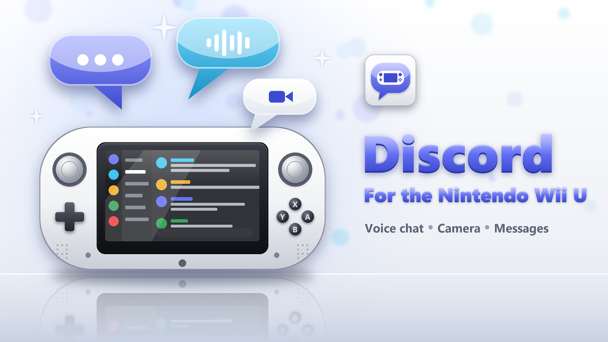

<div align="center">



# Discord For The Nintendo Wii U
### (Working VC and Camera!)

**Mingus Discord** is a native Discord client for the Wii U, with voice chat, cameras and Go Live viewing, running as a homebrew app on [Aroma](https://aroma.foryour.cafe/).

[**⬇ Download**](https://github.com/Cuppaxx/Discord-For-The-Nintendo-Wii-U/releases/latest) · [**📖 Manual**](docs/MANUAL.md) · [**🛠 Building**](docs/BUILDING.md) · [**🐞 Report a bug**](https://github.com/Cuppaxx/Discord-For-The-Nintendo-Wii-U/issues/new/choose)

</div>

---

## Features

| | |
|---|---|
| 💬 **Text chat** | Servers, folders, channels, DMs and group DMs. Send, reply, edit, delete, pin, @mention and react. Markdown, spoilers, code blocks, link cards, typing indicators and unread markers. |
| 🎙️ **Voice chat** | Join voice channels and DM calls with the GamePad mic. Supports Discord's end-to-end encryption (DAVE), per-user volume up to 300%, noise suppression, echo reduction, push-to-talk and a mic test. |
| 📷 **Camera** | Turn on the GamePad camera in a call and see everyone else's cameras (hardware H.264 decoding), with focus and full-screen views. Exposure and saturation are adjustable. |
| 📺 **Go Live** | Watch your friends' screen shares. |
| 📞 **Calls** | Ring friends from a DM, or answer incoming calls (with a ringtone). |
| 😀 **Emoji & GIFs** | Unicode, server and "All servers" emoji, a recent list, a GIF search, stickers, and animated GIF/WebP/MP4 playback. |
| 🎤 **Media** | Record and send voice messages and 30-second video clips. Images, videos and audio files play inline. |
| 🔐 **Sign-in** | Scan a QR code with the Discord phone app (no typing a password on the Wii U), or paste a token. |
| 🐦 | There is a bird. Tap it. |

## Install

1. Your Wii U needs the **[Aroma](https://wiiu.hacks.guide/)** homebrew environment.
2. Download **`MingusDiscord.wuhb`** from the [latest release](https://github.com/Cuppaxx/Discord-For-The-Nintendo-Wii-U/releases/latest).
3. Copy it to your SD card at **`SD:/wiiu/apps/MingusDiscord.wuhb`**.
4. Put the SD card back and turn on the console. **Mingus Discord** appears on the Wii U Menu.
5. Open it, choose **Log in with QR code**, and scan the code with the Discord app on your phone (**You → Scan QR Code**).

The full guide to every screen and button is in the **[Manual](docs/MANUAL.md)**.

## Status

This is a hobby project, tested on a retail Wii U (Aroma) and in Cemu 2.6.

| Works on real hardware | Works, less tested |
|---|---|
| Text chat, DMs, emoji, media | Your camera on **mobile** viewers (it works on desktop) |
| Voice receive and send, incl. E2EE | Watching every kind of camera / Go Live stream |
| Your camera to desktop viewers | Gateway auto-resume after a dropped connection |
| Big accounts (130+ servers) log in in ~7 s | Settings: camera exposure / saturation |

See [Known limitations](docs/MANUAL.md#known-limitations) for what isn't supported yet (threads/forums, loading older messages, Go Live audio, starting your own Go Live).

## ⚠️ Disclaimer

Mingus Discord is an **unofficial** third-party client. It is **not affiliated with, endorsed by or supported by Discord Inc. or Nintendo**. Using third-party clients is against Discord's Terms of Service, and your account could be actioned. **Use it at your own risk.** "Discord" and "Wii U" are trademarks of their respective owners.

Your login token is stored only on your own SD card (`SD:/wiiu/apps/MingusDiscord/token.txt`). It is never sent anywhere except to Discord. **Never share that file or post your log files publicly without checking them first.**

## Building from source

You need devkitPro (devkitPPC + wut + the Wii U portlibs), Python 3 and the prebuilt dependency bundle from the Releases page:

```sh
python tools/build.py
```

The full instructions are in [docs/BUILDING.md](docs/BUILDING.md). How the dependencies (DAVE/libdave, mlspp, OpenSSL, x264, FFmpeg) were built for the Wii U is described in [deps/README.md](deps/README.md).

## License

Mingus Discord is free software under the **[GNU GPL v3.0](LICENSE)**. It links x264 (GPL) and OpenSSL 3 (Apache-2.0), so the combined program must be GPLv3. The bundled libraries and fonts keep their own licenses; see [THIRD_PARTY.md](THIRD_PARTY.md).
