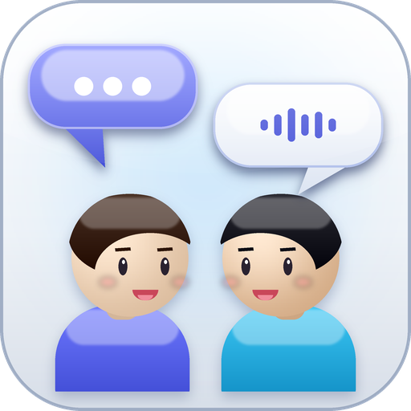

<div align="center">


# User Manual
### Discord: For the Nintendo Wii U

</div>

**Contents**
1. [Installing](#1-installing)
2. [Signing in](#2-signing-in)
3. [Finding your way around](#3-finding-your-way-around)
4. [Chatting](#4-chatting)
5. [Emoji, GIFs and media](#5-emoji-gifs-and-media)
6. [Voice calls](#6-voice-calls)
7. [Cameras and Go Live](#7-cameras-and-go-live)
8. [Settings](#8-settings)
9. [Files on your SD card](#9-files-on-your-sd-card)
10. [Troubleshooting](#10-troubleshooting)
11. [Known limitations](#known-limitations)
12. [Quick reference card](#quick-reference-card)

---

## 1. Installing

You need a Wii U running the **Aroma** homebrew environment ([guide](https://wiiu.hacks.guide/)).

1. Download `DiscordWiiU.wuhb` from the [Releases page](https://github.com/Cuppaxx/Discord-For-The-Nintendo-Wii-U/releases/latest).
2. Copy it to `SD:/wiiu/apps/DiscordWiiU.wuhb`.
3. Start the console. **Discord: For the Nintendo Wii U** appears on the Wii U Menu, alongside your games.

To update, replace the `.wuhb` file with the newer one. Your login and settings are kept, because they live in a separate folder (`SD:/wiiu/apps/MingusDiscord/`).

## 2. Signing in

The first time you open the app, it shows **Welcome back!** with two choices.

### Log in with QR code (recommended): press **Y** or tap it
1. The first time, the app spends a few seconds on **Creating a secure key…**. After that the key is cached.
2. A QR code appears. On your phone, open **Discord → You (your avatar) → Scan QR Code** and scan it.
3. The Wii U shows **Almost there – Hi <your name>!**. Confirm the login on your phone.
4. **Logging you in…** follows, and then you're in.

If it fails, you'll see **Couldn't log in**; press **Y** to try again. **B** goes back.

### Enter a token instead: press **A** or tap it
The software keyboard opens; paste or type your Discord token. If the text is too short, the app says *"That doesn't look like a token"*.

> 🔒 Your login is saved to `SD:/wiiu/apps/MingusDiscord/token.txt`. Anyone with that file can use your account. Never share it, and don't post it online.

### Logging out
Open **Settings** (the ⚙️ gear in the bottom-left user panel) → **Log out**, then press **A** again on *"Log out? Press A again to confirm"*. **B** cancels.
Logging out leaves any call, disconnects, and empties `token.txt`.

## 3. Finding your way around

The screen has three panes:

```
┌──────┬────────────────┬───────────────────────────────┐
│ 🟣   │ # general      │                               │
│ 🟢   │ # memes        │        messages               │
│ 📁   │ 🔊 Voice       │                               │
│ 🔵   │   👤 friend    │                               │
│      │                │                               │
│ 🐦   │ [you] 🎤 🎧 ⚙️ │ [ + ][ GIF ][ 🙂 ] message… [Send]│
└──────┴────────────────┴───────────────────────────────┘
 servers  channels / DMs              chat
```

* **Server rail (left):** your DMs, then your servers in your Discord order, with collapsible coloured **folders**.
* **Channel list (middle):** text, announcement and voice channels. Each voice channel lists who is in it, with speaking 🟢, muted, deafened, **LIVE** and camera indicators. At the bottom is your **user panel** (🎤 mute, 🎧 deafen, ⚙️ settings).
* **Chat (right):** the messages and the composer.

### Moving around

| Input | What it does |
|---|---|
| **D-pad ↑/↓** or **left stick** | Move in the rail or list. In chat, the left stick scrolls. |
| **A** | Open a server or folder, open a channel, or **join a voice channel**. In chat: send the draft, or open the keyboard if the draft is empty. |
| **→ / R** | Next pane (rail → list → chat) |
| **← / L** | Previous pane |
| **B** | Clear the draft. If there is no draft, go back one pane. |
| **X** | Open the keyboard. On a voice channel in the list, opens that channel's **text chat**. |
| **Y** | Refresh servers, channels and messages |
| **ZL / ZR** | Scroll the chat a page up / down |
| **Right stick** | Scroll the chat |
| **+** | Attach menu (in chat) |

**Touch:** tap anything to select it, and drag to scroll. A touch only counts as a tap if your finger moves less than a little; a bigger movement scrolls instead. There are no long-presses.

> When the GamePad keyboard is open, the app ignores buttons and touches until you press **OK** on the keyboard. A banner reminds you: *"Typing on the GamePad keyboard – press OK when done"*.

## 4. Chatting

### Writing
* Tap the message field (or press **X**) to open the keyboard. When you press **OK**, the text becomes your draft.
* Press **A** or tap **Send** to send it. If what you typed ends with a new line, it is sent right away.
* **B** clears the draft.

### Message actions
Select a message with **D-pad ↑/↓** in chat and press **A**, or tap the message:

* **Open attachment** (media only)
* **Reply**
* **Add reaction**
* **Mention**
* **View profile**
* **Edit** (your own messages)
* **Delete** (your own, or anyone's with *Manage Messages*; press **A** to confirm)
* **Pin** (with *Manage Messages*)

**B** backs out of edit, then out of the selection, then out of the reply.

### What you'll see
* Messages from the same person are grouped, with date dividers between days.
* Markdown: **bold**, *italics*, __underline__, ~~strike~~, ||spoilers||, `code`, code blocks, quotes, headers and links. Mentions are highlighted.
* Replies, forwarded messages, link previews, reaction chips (tap one to add or remove your reaction), and *"X is typing…"*.
* **Unread** channels and DMs have a white pill and a **bold** name.
* **Tap an avatar or name** to open that person's profile, which has **Message** (opens a DM) and **Options** buttons.
* A new DM shows a small **toast** at the top with the sender and message.

## 5. Emoji, GIFs and media

### Emoji picker (🙂 button, or **+** → Emoji)
| Input | Action |
|---|---|
| **L / R** or **ZL / ZR** | Switch category: Recent, servers, **All servers**, Unicode |
| **D-pad** / tap | Move / pick |
| **A** | Insert the emoji (the picker stays open so you can add more) |
| **Right stick** / drag | Scroll |
| **Y** | Switch to GIFs |
| **B** | Close |

**All servers** loads the emoji from every server you're in, one server at a time (*"loading n/N servers"*). Each emoji shows which server it's from.

### GIFs (**GIF** button)
Trending GIFs show first. Press **X** or tap the search field to search. Pick one with **A** or a tap and it's sent straight away; your draft is kept. **Y** goes back to emoji, and **B** closes.

### Attach menu (**+**)
* **Voice message:** record with the GamePad mic (up to 2 minutes). **A** sends, **X** stops so you can listen back, **B** cancels.
* **Video clip:** records 30 seconds of camera and mic. **A** sends, **X** stops, **B** cancels.
* **GIF / Emoji:** shortcuts to the pickers.

You can't record voice messages or clips while you're in a call, because the call is using the mic.

### Viewing media
Images, animated GIF/WebP, MP4 videos, audio files, voice messages (shown with a waveform) and stickers display inline. Tap one, or use **Open attachment**, to open the viewer:

| Input | Action |
|---|---|
| **A** / tap | Play / pause |
| **← / →** | Back / forward 10 s |
| **ZL / ZR** | Back / forward 60 s |
| Tap the progress bar | Seek |
| **B** | Close |

## 6. Voice calls

### Joining
* **Voice channel:** select it in the channel list and press **A** (or tap it).
* **Calling a friend:** in a DM, press **R** or tap **R Call**. The call screen shows **Ringing…**, then **No answer** after 60 seconds.
* **Incoming call:** a full-screen card appears and a ringtone plays. Press **A** or tap the left half to **accept**, or **B** or tap the right half to **decline**.

### In the call screen
| Input | Action |
|---|---|
| **X** | Mute / unmute your mic |
| **ZL** | Deafen |
| **R** | Camera on / off |
| **Y** | Open the call's text chat (press **Y** again in that chat to come back) |
| **A** | **People in this call** list |
| **+** | Settings |
| **ZR** (hold) | Push to talk, if enabled |
| **B** | **Leave the call.** There is no confirmation, so be careful! |

The call screen shows whether the call is **end-to-end encrypted** (Discord's DAVE protocol, which is supported).
From the channel list you can also use the **voice panel** at the bottom: the red ☎️ button disconnects, and tapping the rest of the panel opens the call.

### Per-person options
Tap a person's tile, or choose them from **People in this call**, to open the **member menu**:
* **Volume:** use **← / →** in 10% steps (0–300%), or tap the bar. This is remembered for that person.
* **Mute for me:** silence them only for you.
* **View profile.**
* With server permissions: **Server mute / deafen, Disconnect, Timeout 10 min, Kick, Ban**. Kick and Ban ask you to press **A** again.

## 7. Cameras and Go Live

### Your camera
Press **R** in a call to turn the GamePad camera on or off. Use **Settings → Camera exposure / saturation** if the picture is too dark or too pale.

### Watching others
Everyone with a camera or a Go Live stream appears as a **video tile**.

| View | Controls |
|---|---|
| **Grid** | **D-pad ↑/↓** shows a cursor; **A** opens the tile. Tapping a tile opens it. The **Watch / Stop** chip starts or stops a Go Live stream, and **…** opens the member menu (volume etc.). |
| **Focus** | **A** / tap: full screen · **B**: back to the grid · **← / →**: next video · **ZR**: stop watching a stream · **−** or **Options**: member menu |
| **Full screen** | **B**: back to focus · **← / →**: next video · **ZR**: stop watching · tap: show the controls |

> Go Live streams play **without sound** for now. Starting your own Go Live isn't supported yet.

## 8. Settings

Open Settings with the ⚙️ gear in the user panel, or **+** in a call. Use **↑/↓** to choose an item, **← / →** to change it, **A** to toggle, and **B** to close. A live **mic level** meter shows how loud you are, with a marker for the "speaking" threshold.

| Setting | What it does | Range (default) |
|---|---|---|
| Input volume | Mic boost | 50–400% (100%) |
| Automatic gain control | Evens out your volume | On / Off (Off) |
| Input sensitivity | When you count as "speaking" | Automatic, or 1–100 |
| Noise suppression | Removes background noise | On / Off (On) |
| Echo reduction | Stops the TV speakers feeding back into the mic | On / Off (On) |
| Push to talk | Only send voice while **ZR** is held | On / Off (Off) |
| Opus mode | *Voice*, or *Music* for better quality with music | Voice / Music |
| Bitrate | Voice quality you send | 16–128 kbps (64) |
| Loss protection (FEC) | Helps on bad Wi-Fi | On / Off (On) |
| Output volume | Everyone's volume | 0–200% |
| Mic test | Hear yourself, works outside calls too | On / Off |
| Camera exposure | Brighter / darker camera | −1.5 to +1.5 EV |
| Camera saturation | More or less colour | 0–200% |
| Log out | Press twice to confirm | |

Settings and per-person volumes are saved in `uservol.txt`.

## 9. Files on your SD card

Everything the app saves is in `SD:/wiiu/apps/MingusDiscord/`. The folder keeps the app's original name, so logins and settings carry over between versions.

| File | What it is |
|---|---|
| `token.txt` | 🔒 Your login. **Keep it private.** Delete it to log out. |
| `uservol.txt` | Settings and per-person volumes |
| `readstate.txt` | Which messages you've seen (for unread markers) |
| `recent_emoji.txt` | Your recently used emoji |
| `ra_key.der` | Cached key for QR login |
| `log.txt` | Debug log, rewritten on every launch |

Developer and test switches such as `nomic.txt`, `vsend_dry.txt`, `gwdrop.txt`, `vtest.h264` and the `config.txt` keys are covered in [BUILDING.md](BUILDING.md#test-switches). You don't need them for normal use.

## 10. Troubleshooting

| Problem | Try this |
|---|---|
| **Stuck on "Connecting…"** | Check the console's internet connection. Big accounts take about 7 seconds. The app reconnects by itself if the connection drops. |
| **QR code won't scan / "Couldn't log in"** | Press **Y** to get a fresh code. Make sure you're scanning from **Discord → You → Scan QR Code**, not the phone's camera app. |
| **I keep getting logged out** | Your token was revoked, for example because you changed your password or used "log out of all devices". Log in again. |
| **Nobody can hear me** | Check you aren't muted (**X**) or deafened (**ZL**), and that *Push to talk* is off. Use **Mic test** in Settings, and try raising *Input volume*. |
| **I can't hear someone** | Open their member menu and check their volume, and that *Mute for me* is off. |
| **Echo for the other people** | Turn on *Echo reduction*, or lower the TV volume. |
| **A camera stays black** | Wait for the next keyframe (a few seconds), or leave the tile and open it again. |
| **Something else is wrong** | Open an [issue](https://github.com/Cuppaxx/Discord-For-The-Nintendo-Wii-U/issues/new/choose) with `log.txt` attached. **Open `log.txt` first and make sure there is no token in it.** |

## Known limitations

* **Threads, forums and stage channels** aren't listed yet. Text, announcement and voice channels are.
* Only the **latest 40 messages** of a channel load; you can't scroll back further yet.
* **Go Live** streams have no sound, and you can't start your own stream.
* **Lottie** (animated vector) stickers don't display.
* There are no system notifications; new DMs show as a toast inside the app.
* Limits: 200 servers, 600 channels per server, 32 people in a call, 4 video streams decoded at once.
* You can't record voice messages or clips during a call.

## Quick reference card

```
 MAIN SCREEN                         CALL SCREEN
 ↑↓ / stick   move                   X    mute          ZL   deafen
 A            open / join / send     R    camera        Y    text chat
 ← → / L R    switch pane            A    people        +    settings
 B            back / clear draft     ZR   push-to-talk (hold)
 X            keyboard               B    LEAVE CALL
 Y            refresh
 ZL ZR        page up / down         VIDEO
 +            attach menu            A    focus / full screen
                                     ← →  next video     B  back
 Log out: ⚙️ Settings → Log out → A  ZR   stop watching  −  options
```
